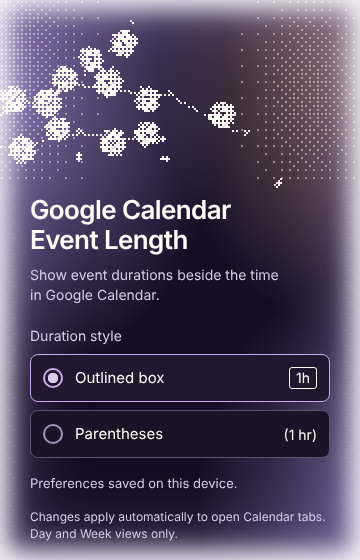

# Google Calendar Event Length

**See how long an event lasts, right beside its time.**

An independent Chrome extension for Google Calendar's Day and Week views. Turn durations on or off and choose an outlined badge or simple parentheses from a small monochrome popup with an animated purple ASCII tear-away calendar.



*The real unpacked extension popup, captured at 2× (actual size 300 × 400).*

This version's design is inspired by [this post by @praveenisomer](https://x.com/praveenisomer/status/2032418900298887633). Credit to him for the ASCII idea.

## What it does

- Turns `9:11–11:32pm` into **`2h 21m`** or **`(2 hr 21 min)`**—no mental math.
- Puts durations **beside the time**, including tall events and events with locations.
- Uses black or white for contrast, and hides the label when it cannot fit without covering the original time.
- Saves your style choice locally and updates open Calendar tabs automatically.
- Animates a purple ASCII tear-away calendar **only inside the popup**. Reduced-motion preferences draw a single still frame; closing or hiding the popup stops animation.

No backend, external API, analytics, or separate sign-in. Not affiliated with or endorsed by Google.

## Install it now

This project is currently distributed as an unpacked extension; it has not been published to the Chrome Web Store.

1. Extract the **install ZIP**, or download this repository.
2. In Chrome, open **`chrome://extensions`** and turn on **Developer mode**.
3. Click **Load unpacked**. Select the folder containing `manifest.json`: `google-calendar-event-length` from the install ZIP, or `extension/` from the repository. Do not select the repository root.
4. Refresh Google Calendar and select **Day** or **Week**.
5. Click Chrome's **Extensions** puzzle-piece icon → **Google Calendar Event Length**. Pin it if you want the popup one click away.
6. Use **Show durations** to turn labels **On** or **Off**, and choose **Outlined box** or **Parentheses**. There is no Save button: each change saves immediately and updates open Calendar tabs without a refresh. Turning durations off removes every label; turning them back on restores them in your chosen style.

**Already installed an earlier version?** Replace the files in the same extension folder, click **Reload** on its Chrome extension card, and refresh Calendar. This loads the new popup without changing the extension's ID or clearing your preference. Moving to a different folder can create a second installation; disable/remove the old one to avoid duplicate extensions.

**“Manifest file is missing”?** You selected the wrong folder. Open it and select the inner folder that actually contains `manifest.json`.

## What is—and isn't—supported

| Supported | Deliberately skipped |
| --- | --- |
| Timed events in explicit Day/Week views | All-day events and other views |
| English AM/PM, 24-hour times, noon/midnight | Unsupported locale formats |
| Same-day ranges with unambiguous start/end times | Overnight, multi-day, reversed, or ambiguous ranges |
| Exact hours and minutes | Time-zone/DST-aware elapsed-time calculations |
| Updating labels after DOM changes and navigation | Short events (about 30 minutes or less) that Calendar shows with only a start time |

**Short events: click to see the duration.** Google Calendar draws events of about 30 minutes or less as a single line with only the start time (for example "busy, 2pm"), so the grid has no end time to measure. Click any event and the duration appears next to its time in Calendar's event details popup, for every length. Turning **Show durations** off hides these too.

If a label doesn't fit, it disappears rather than resizing the event or truncating its time. Google Calendar's markup is not a public extension API and may change. If labels stop appearing, a redacted **Copy outerHTML** sample of an event block helps diagnose the selector without sharing your login.

## Privacy and permissions

The extension reads supported Calendar event time text and nearby DOM metadata **locally**, to calculate durations and identify eligible blocks. Event content is not saved or transmitted. Only your `durationEnabled` (on/off) and `durationStyle` preferences are saved in Chrome's local extension storage.

- **Site access:** `https://calendar.google.com/*` only.
- **`storage`:** remembers whether durations are on and which style you chose, and updates other open Calendar tabs.
- Fonts, illustration, scripts, and fallback artwork are packaged locally; there are no remote assets.

Read the [privacy policy](PRIVACY.md). The calendar animation is decorative and cannot intercept clicks or keyboard focus.

## Develop and test

The extension needs no build step. For tests, use Node 22+:

```sh
npm ci
npx playwright install chromium
npm test
npm run test:browser
```

On a minimal Linux machine, install browser system dependencies with `npx playwright install --with-deps chromium`.

To build both release ZIPs with Python 3:

```sh
python3 scripts/package.py
```

Outputs go to `artifacts/`:

- `*-install.zip`: extract it and load the resulting folder in Chrome.
- `*-store.zip`: upload this ZIP directly to the Web Store; `manifest.json` is at its root.

`npm run demo` starts the **synthetic Calendar fixture** at `http://localhost:4173`. It is not live Google Calendar. `design-preview/` preserves the original design sandbox; the shipped popup lives in `extension/`.

## Verification

The test suite covers time parsing, manifest scope, duplicate/stale-label cleanup, inline fit, contrast, navigation, and actual MV3 injection on controlled Calendar-origin fixtures. It loads the real popup and checks the exact 300 × 400 size with no overflow, monochrome UI colors, the on/off switch, both style choices, persistence after reopening, instant changes in two supported fixture tabs, keyboard focus, loading/saving/error states, motion, reduced motion, hidden-page pausing, device-resolution canvas, and absence of remote requests.

Earlier versions were inspected on live Google Calendar for Day/Week labels, navigation, and clicking. **This release's automated Calendar checks use controlled fixtures**, not a fresh live Calendar session. Real event edits and drag/resize behavior should still be checked by hand on live Calendar.

## Project layout

```text
extension/       Installable Manifest V3 extension
tests/           Parser, Calendar-fixture, and real-popup tests
docs/            Screenshots, store copy, and publishing guide
scripts/         Demo server and ZIP packaging
design-preview/  Historical sakura design sandbox (no longer shipped)
```

The popup uses the locally bundled Inter font; its licenses are in `extension/fonts/`. The animation in `extension/calendar.js` is the supplied fixed-grid tear-away ASCII calendar script, adapted only to size itself to the popup canvas, pause when hidden, and draw a still frame for reduced motion.

**Heading font:** the design uses **Daisler Light** (Eko Bimantara). No licensed font file is in this repository, and the free trial is personal-use only, so it is not bundled. The popup uses Daisler Light if it is installed on the computer and otherwise falls back to Georgia. To ship it, buy a license that permits embedding the font in distributed software (a desktop or webfont license alone does not cover that; confirm with the foundry), add the file to `extension/fonts/`, and point the `Daisler` `@font-face` in `popup.css` at it.
